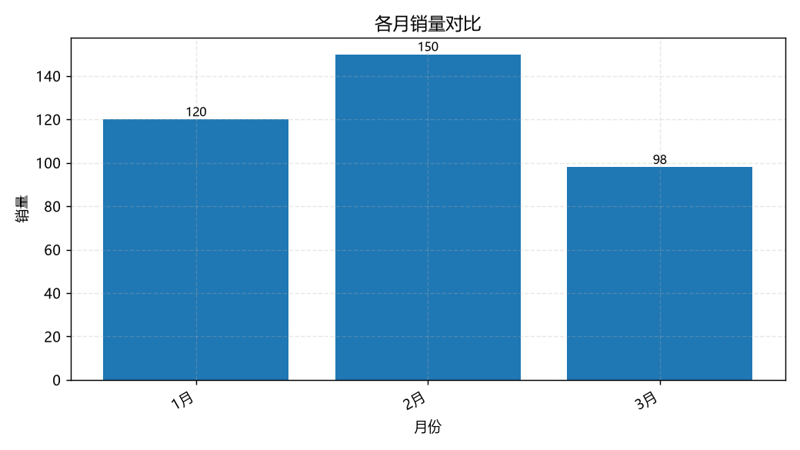

# 智能小秘书 · MCP + LangGraph 多 Agent 个人助理

一个可本地运行的中文智能助理：**Gradio 界面 + LangGraph 编排 + 自建 MCP 工具服务端 + DeepSeek 推理**。
支持「单 Agent（ReAct）」与「多 Agent（Supervisor + 3 专家）」两种编排模式，界面上可一键切换并观察调度过程。

<p>


</p>

---

## 一、它能做什么

| 能力 | 实现方式 |
| --- | --- |
| 联网检索公开信息 | MCP 工具 `my_search`（Tavily / 智谱 / HTML 三路降级） |
| 解析网页正文 | MCP 工具 `fetch_webpage`（BeautifulSoup 抽取正文） |
| 天气、火车票、路线规划 | `get_weather` / `query_train_ticket`（12306）/ `plan_route`（OSRM + Nominatim） |
| 数学计算与数据可视化 | `calculator` / `add` / `multiply` / `analyze_and_chart`（matplotlib） |
| 流式对话与工具调用可视化 | Gradio 6 + `astream`，工具调用折叠展示、专家交接卡片 |



> 上图由 `analyze_and_chart` 工具在对话中实时生成（用户口述数据 → 模型调用工具 → 返回图片路径 → 界面渲染）。

---

## 二、架构

### 单 Agent 模式（`agent/my_agent.py`）

一个 LLM 实例 + 全部工具，在单个 ReAct 循环内自行决定调用哪个工具，适合单步、边界清晰的任务。

### 多 Agent 模式（`agent/multi_agent.py`，默认）

```
用户提问
   │
   ▼
┌─────────────┐  只输出一个专家名 / FINISH
│ Supervisor  │──────────────┐
│  调度中心    │              │
└──────┬──────┘              │
       │ 条件路由             │ 信息已足够
       ▼                     ▼
┌────────────┬────────────┬────────────┐      ┌───────────┐
│ researcher │  travel    │    data    │      │ summarize │
│ 研究专家    │  出行专家   │  数据专家   │      │  对外汇总  │
│ 搜索/抓网页 │ 天气/票/路线│ 计算/出图   │      └─────┬─────┘
└─────┬──────┴─────┬──────┴─────┬──────┘            │
      └────────────┴────────────┘                   ▼
              回到 Supervisor 判断是否还需下一位专家   输出答复
```

对应 LangGraph 的 `StateGraph` + `add_conditional_edges` + 共享状态 `MultiAgentState`：

```python
class MultiAgentState(TypedDict):
    messages: Annotated[Sequence[BaseMessage], add_messages]
    next_agent: str      # 调度中心决定的下一位专家
    visited: list[str]   # 已出场专家，用于防死循环
```

### 三层解耦

```
┌────────────────────┐   MCP (streamable_http / sse)   ┌──────────────────────┐
│  Gradio 界面        │ ─────────────────────────────▶ │  本地 FastMCP 服务端  │
│  agent/app.py      │                                │  mcp_server/          │
│        │           │ ◀───────────────────────────── │  10 个工具            │
│        ▼           │      tools / prompt / resource  └──────────────────────┘
│ LangGraph 编排层    │
│  单 Agent / Supervisor 多 Agent                       ┌──────────────────────┐
│        │           │ ─────────────────────────────▶ │  DeepSeek Chat API    │
└────────────────────┘                                └──────────────────────┘
```

**界面层、编排层、工具层互不耦合**：换模型只改 `llm_models/all_llm.py`，加工具只改 `mcp_server/`，换编排只改 `agent/`。

---

## 三、关键设计取舍

1. **工具全部本地自建，不依赖第三方公共 MCP 服务。**
   公共 MCP 服务端绑定作者自己的配额与密钥，换机器大概率不可用。本项目把工具实现在 `mcp_server/tools.py`，默认只连本地服务，开箱即跑；原设计中的远程服务端保留在 `config/mcp_config.py` 的 `REMOTE_MCP_SERVERS` 中，按需开启。
2. **MCP 版本冲突的规避。** `langchain-mcp-adapters` 要求 `mcp>=1.24,<2.0`，而 `fastmcp` 2.x 要求更高版本，两者冲突。因此直接使用官方 SDK 内置的 `mcp.server.fastmcp`，不额外安装 `fastmcp` 包。
3. **多 Agent 的收敛控制。** Supervisor 由提示词约束只输出单个专家名；状态中记录 `visited`，达到 `max_hops`（默认 4）强制 `FINISH`，避免专家之间无休止转交。
4. **沙箱计算。** `calculator` 用 `ast` 白名单解析表达式，不使用 `eval`，避免执行任意代码。
5. **密钥统一出口。** 所有密钥经 `env_utils.py` 从 `.env` 读取，代码中不出现明文；`.env` 已在 `.gitignore` 中。

---

## 四、快速开始

**环境**：Python ≥ 3.10（在 3.13 上验证通过），Windows / macOS / Linux 均可。

```bash
git clone https://github.com/<你的用户名>/smart-secretary.git
cd smart-secretary

python -m venv .venv
# Windows
.venv\Scripts\activate
# macOS / Linux
source .venv/bin/activate

pip install -r requirements.txt
```

**配置密钥**：复制模板后填入自己的 DeepSeek Key（[申请地址](https://platform.deepseek.com/)）

```bash
cp .env.example .env
```

```ini
DEEPSEEK_API_KEY=sk-你的密钥
DEEPSEEK_BASE_URL=https://api.deepseek.com
DEEPSEEK_MODEL=deepseek-chat

MCP_HOST=127.0.0.1
MCP_PORT=8000
MCP_SSE_PATH=/sse
MCP_STREAMABLE_PATH=/streamable
```

**启动**（一条命令同时拉起 MCP 服务端与界面）：

```bash
python run.py
```

浏览器打开 <http://127.0.0.1:7860>。Windows 也可直接双击 `启动.bat` / `关闭.bat`。

只想跑编排层、不开界面：

```bash
python -m agent.multi_agent    # 多 Agent 冒烟测试
python -m agent.my_agent       # 单 Agent 冒烟测试
```

---

## 五、项目结构

```
smart_secretary/
├── run.py                      # 一键启动：MCP 服务端 + Gradio 界面
├── env_utils.py                # 环境变量统一入口
├── requirements.txt
├── .env.example                # 配置模板
├── agent/                      # 编排层
│   ├── app.py                  # Gradio 界面、流式输出、模式切换
│   ├── my_agent.py             # 单 Agent（ReAct）
│   ├── multi_agent.py          # 多 Agent（Supervisor + 3 专家）
│   └── my_llm.py               # LLM 工厂
├── mcp_server/                 # 工具层
│   ├── tools.py                # 10 个 MCP 工具实现
│   ├── start_streamable_server.py
│   └── start_sse_server.py
├── config/mcp_config.py        # MCP 服务端清单（本地 / 远程）
├── llm_models/all_llm.py       # 模型定义
├── tests/smoke_test.py
└── docs/                       # 详细说明与配图
```

---

## 六、MCP 工具清单

| 工具 | 说明 | 依赖 |
| --- | --- | --- |
| `my_search` | 联网搜索，Tavily → 智谱 → HTML 抓取三级降级 | 可选 `TAVILY_API_KEY` / `ZHIPU_API_KEY` |
| `fetch_webpage` | 抓取网页并抽取正文 | beautifulsoup4 |
| `get_current_time` | 按指定时区返回当前时间 | — |
| `get_weather` | 城市天气查询 | httpx |
| `query_train_ticket` | 12306 车次查询 | httpx |
| `plan_route` | 路线规划（driving / walking / cycling） | OSRM + Nominatim |
| `calculator` | 安全表达式求值（AST 白名单） | — |
| `add` / `multiply` | 基础运算，供模型稳定调用 | — |
| `analyze_and_chart` | 结构化数据 → 统计 + matplotlib 图表 | pandas / matplotlib |

---

## 七、常见问题

- **`mcp` 版本报错**：不要额外 `pip install fastmcp`，本项目使用官方 SDK 内置的 FastMCP；若环境里残留 fastmcp，先卸载。
- **MCP 端口占用**：改 `.env` 中 `MCP_PORT` 后重启即可，`run.py` 会先探测端口再启动界面。
- **`Author identity unknown`**：`git config --global user.name/user.email` 未配置。
- **界面能打开但工具不生效**：检查 MCP 服务端是否已就绪（`run.py` 启动日志中的 `服务端就绪`），或先单独运行 `python -m mcp_server.start_streamable_server` 排查。

---

## 八、Roadmap

- [ ] 把 `visited` 的字符串列表换成结构化任务队列，支持同一专家多次出场
- [ ] 引入长期记忆（checkpointer 从 `InMemorySaver` 迁移到 SQLite）
- [ ] 为 MCP 工具补单元测试，覆盖率目标 60%
- [ ] 支持 MCP 工具动态注册（不改代码即可接入外部 MCP 服务端）

---

## 九、文档

- [`docs/项目详细说明.md`](docs/项目详细说明.md)：环境搭建、工具实现细节、调试记录
- [`MULTI_AGENT.md`](MULTI_AGENT.md)：单 Agent 与多 Agent 两种编排模式的逐项对比

